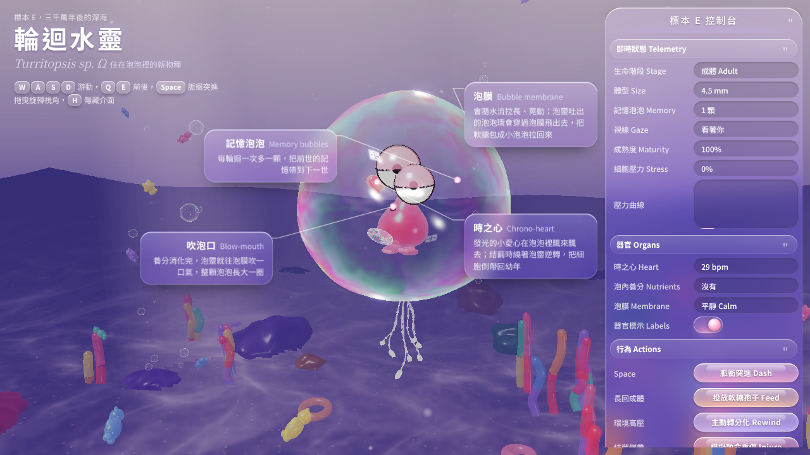
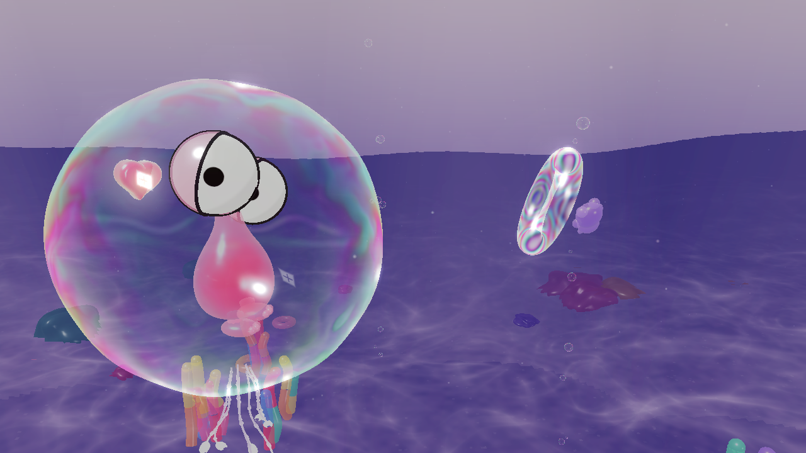
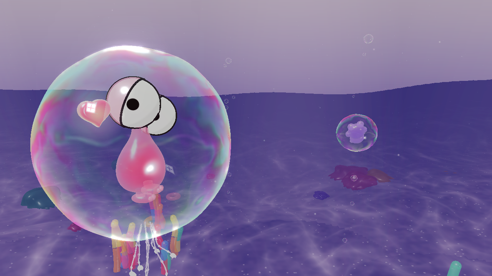
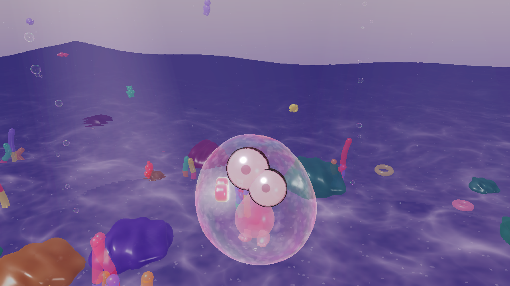
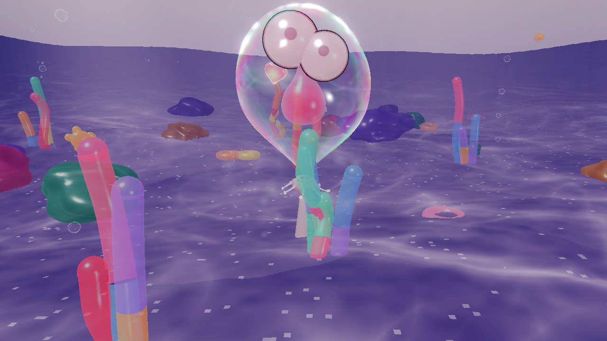
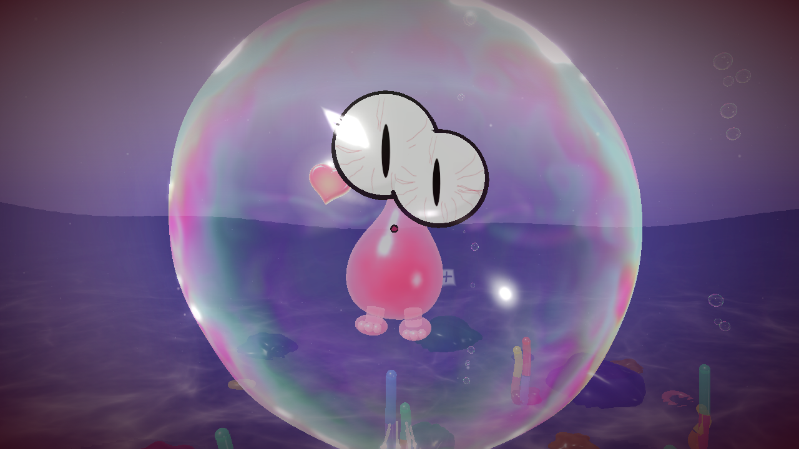

# M2 物種

> 截止：10/15（四）上課前 15:30
> 這一站在做什麼、怎麼做、卡住看哪裡，都在課程頁：<https://course.interaction.tw/oop/#milestones>

> 這一站是**報告站**：每個人上台三分鐘，簡報一律轉成 PDF 放這個資料夾。

在你的世界裡長出站得住腳的物種，並讓牠第一次動起來。

## 這一站要交的四件套

- [x] 程式碼：會動的雛形（`index.html` 與 `sketch.js`）
- [x] 截圖或影片：牠動起來的樣子（見下方「截圖」）
- [ ] 反思：下面那段，一百到兩百字，自己寫
- [ ] AI 揭露欄：下面的表格
- [x] 簡報 PDF：檔名 `m2-簡報.pdf`，放這個資料夾裡；物種設定書五欄也放這裡（簡報第 3 頁）

## 截圖

| | |
|---|---|
|  整體畫面 |  吐泡泡環抓軟糖 |
|  把軟糖拉回泡泡 |  受傷結繭 |
|  水螅吹出新的自己 |  重生後盯著你 |

操作：WASD 游動、Q／E 前後、空白鍵衝刺、H 隱藏介面；右側控制台可以投放軟糖、模擬重傷、召喚天敵。

## 反思

卡在一開始我希望可以讓我的生物伸出像胞吞作用的觸手來進食,但是他做出來的觸手都很僵硬很奇怪,因此我改成了發生泡泡來進食的方式

## AI 揭露欄

| 項目 | 內容 |
|------|------|
| 工具 | Claude（claude.ai 網頁版，模型 Claude Opus 5.5）：設計討論、程式撰寫、簡報與截圖；Claude Code（本機）：把檔案 commit 並 push 到這個 repo |
| 日期 | 2026/10/29 ～2026-11-19 |
| prompt 摘要 | 依序要求：把控制面板改成不像 AI 的樣式（Tweakpane）、把生物做精緻；依參考圖改成水母 → Q 版大眼水母 → 有功能內臟的新物種 → 泡泡外殼（移動像泡泡、吹泡泡式成長）；泡泡裡的生物改成參考圖的手繪大眼風格、小熊軟糖質地、眼皮眨眼、會飄會反彈的發光愛心、先長泡泡再長身體；軟糖孢子、液態玻璃介面、整站軟糖風格；進食方式從觸手、偽足改成吐泡泡環；糖果色海底背景；檢查 WASD／QE／空白鍵／H；做簡報（世界觀、設定書五欄）、拆出 sketch.js |
| 採用範圍 | 程式碼（index.html、sketch.js）幾乎全部由 Claude 依我的指示產生與修改；外觀方向、參考圖、每一版要不要保留，以及世界觀與設定書的原始設定由我決定。截圖與簡報版面也由 Claude 製作。

## 課前準備與物種日誌

過程中的筆記、查到的資料、想到一半的點子，寫在這個資料夾的 `notes.md`（需要時自己建，格式自由）。
